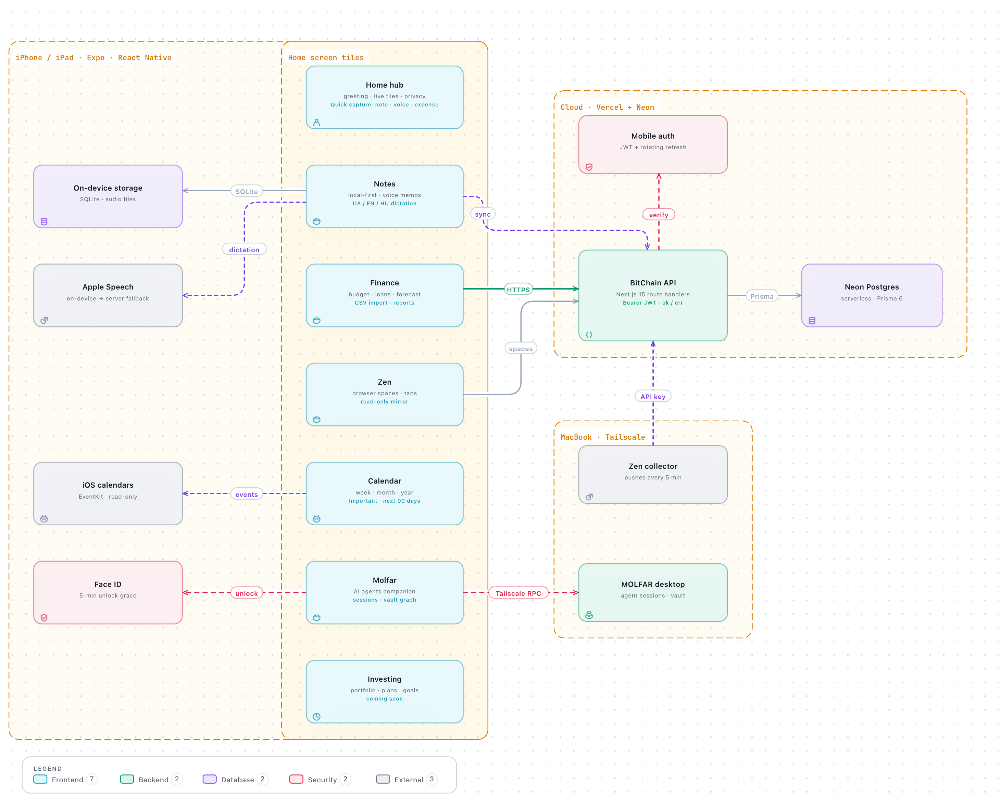
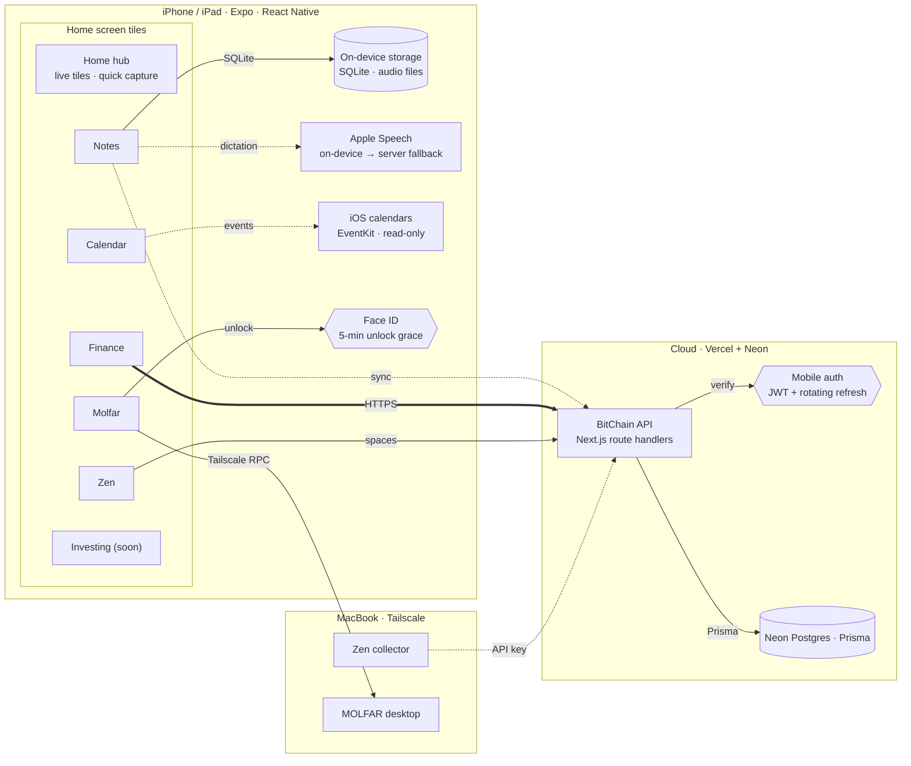
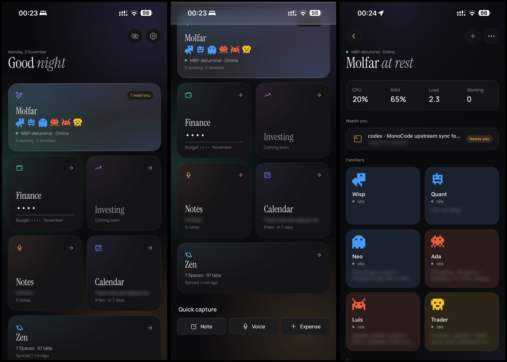
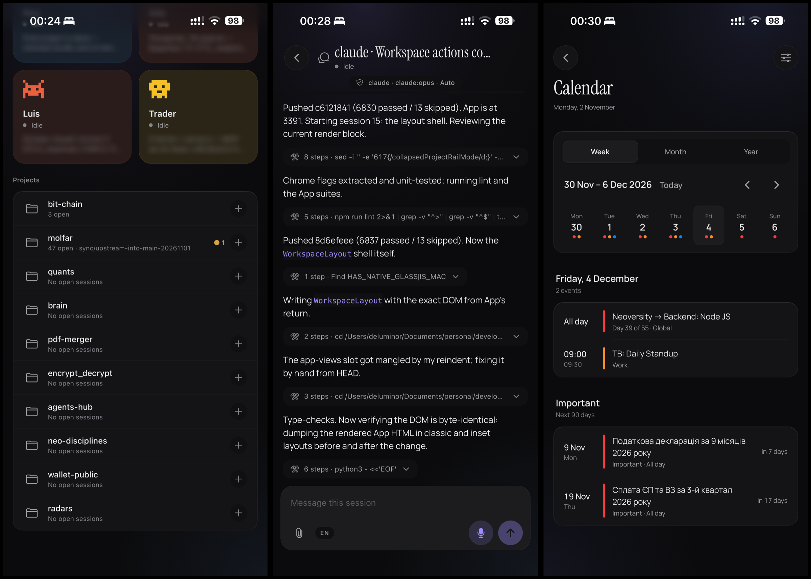
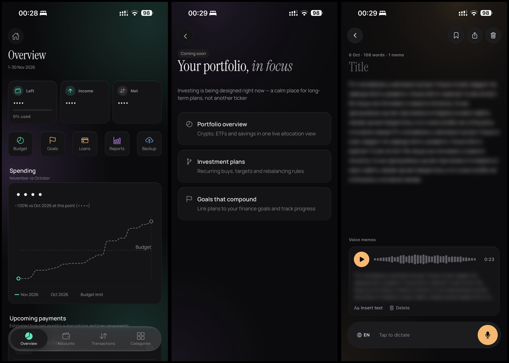

<div align="center">


# BitChain

**A private "life OS" for my phone: money, notes, calendar and my AI agents behind one calm home screen.**


-black?logo=next.js)


</div>

---

## Overview

**BitChain** is a private, local-first personal platform for iPhone and iPad. Finance, notes, calendar, browser sync and a remote console for AI coding agents live as independent modules behind one home screen.

Under the hood it's a full-stack TypeScript monorepo: an Expo / React Native client, a headless Next.js API on Vercel and Neon Postgres. Shared Zod contracts are the single source of truth between them.

- **Modular by design**: each module owns its data layer (requests → normalizers → queries) and its screens. The hub only composes live summaries, and architecture guardrails keep the boundaries honest.
- **Local-first and private**: notes and voice memos live on the device first, amounts can be masked app-wide, agent traffic goes phone ↔ laptop over Tailscale, and every machine integration uses its own scoped key.
- **Production-grade delivery**: spec-first features, strict typing end to end, short-lived JWTs with rotating refresh tokens, tests on pure domain logic, and CI/CD from GitHub Actions to Neon and Vercel.

> Closed personal project. The source is private and there is no public build. This page is a public showcase, hosted next to [MOLFAR](../../../README.md), the desktop agent workspace that BitChain's Molfar module controls. Screenshots use privacy mode and blur wherever real data would show.

---

## At a glance

| | |
|---|---|
| **Platform** | iPhone + iPad (Expo / React Native), native Liquid Glass on iOS 26 with a blur fallback |
| **Modules** | Hub · Finance · Notes · Calendar · Molfar · Zen · Investing (soon) |
| **Backend** | Headless Next.js API on Vercel, Prisma on Neon serverless Postgres |
| **Codebase** | pnpm monorepo: `apps/mobile`, `apps/api`, `packages/api-contracts` |
| **History** | ~400 commits since April 2025, ~90 test files, spec-first features in `docs/specs/` |
| **Built with** | Claude Code + Codex as pair programmers, under strict plan → review → verify gates |

---

## Architecture

<p align="center">
  
</p>

<details>
<summary>Text version (Mermaid)</summary>



</details>

### Key decisions

| Decision | Why |
|---|---|
| **Headless API, mobile-only client** | The web UI was removed in 2.0. One client means one UX to polish, and the API stays a thin, testable boundary. |
| **Shared Zod contracts** (`@bit-chain/api-contracts`) | The phone and the server parse the same schemas and the same `ok / err` envelope, so contract drift fails fast instead of rendering garbage. |
| **Short-lived access JWT + rotating refresh tokens** | 15-minute access tokens. Refresh tokens rotate with family-based reuse detection, so a stolen refresh token kills the whole family. Tokens live in the iOS Keychain via SecureStore; login is rate-limited. |
| **Local-first notes, audio stays on-device** | Instant, offline notes. Voice recordings are personal and heavy, so only text and metadata sync. |
| **Direct phone ↔ laptop over Tailscale for Molfar** | No relay server sees agent traffic. QR pairing, a device token and Face ID add up to defence in depth. |
| **Persisted TanStack Query cache** | The app opens with the last known data and refreshes in the background: on pull-to-refresh, app resume, date rollover and related mutations. |
| **Thin route handlers, domain services** | Route handlers validate, authenticate and delegate. Business rules live in `features/*/services` and are unit-tested. |

### Request flow

```
Phone → axios (Bearer) → /api/mobile/* → getMobileUser() → userId
      → domain service → Prisma → PostgreSQL
      → ok(data) | err(code, message, requestId)
401 → refresh interceptor → rotate tokens → retry once → or sign out
```

---

## Product tour

### Home hub and Molfar at a glance

<p align="center">
  
</p>

**Home hub** (left and centre)

- A time-aware greeting ("Good *night*") and live tiles instead of static icons. Each tile shows the one fact that matters: agents that need me, month budget, latest note, the next important event, synced browser spaces.
- **Quick capture**: a note, a voice memo or an expense in one tap from the home screen.
- **Privacy mode** (eye icon) masks every amount across the app as `• • • •`, so it's safe to open in public or screen-share.
- **Responsive layout**: on iPad and wide windows, gutters scale and the Notes and Molfar modules switch to split workspaces.

**Molfar overview** (right). [MOLFAR](../../../README.md) is my desktop workspace for AI coding agents (this repository); BitChain is its mobile companion.

- **Host at a glance**: CPU, RAM, load and the number of working agents on the laptop.
- **Needs you**: sessions blocked on an approval or a usage limit, one tap away.
- **Familiars**: named agent personas, each with its own role, status and last result.
- **Security model**: the phone pairs by scanning a QR code with a one-time code. It only accepts HTTPS or plain HTTP inside the Tailscale `100.64.0.0/10` range. Every entry is gated by Face ID with a 5-minute grace window, because a paired phone can run agents with full access on the laptop.

### Agent sessions and Calendar

<p align="center">
  
</p>

**Molfar projects and live sessions** (left and centre)

- **Projects → sessions**: open sessions grouped by repository, then by day, with a `+` to start a new session for that project.
- **Live session chat**: read the agent's progress with collapsible tool steps, reply by text or voice, and attach photos or files.
- **Knowledge workspace**: a searchable vault, a 3D force graph of note links and a Markdown editor with optimistic-concurrency saves.

**Calendar** (right)

- **Week, month and year** views over the system calendars I choose (read-only, via EventKit). Color dots per calendar.
- **Important** calendar: a dedicated list from today to +90 days with countdowns ("in 7 days") and day grouping. That's where tax deadlines and other can't-miss dates live. The nearest one also shows on the Hub tile.
- Tapping an event opens it in the native Calendar app. A permission-denied state offers Allow / Open Settings.

### Finance, Investing and Notes

<p align="center">
  
</p>

**Finance** (left, in privacy mode)

- **Overview** for the current period: what's left of the budget, income, net, and shortcuts to Budget, Goals, Loans, Reports and Backup.
- **Spending pace chart**: cumulative spend this month against the same point last month and the budget limit, so "am I over pace?" is visible on day 10, not day 30.
- **Upcoming payments**: a forecast projected from last month's subscriptions and active loan repayments. It's timezone-aware, clamps short months to their last day, caps each payment at the remaining loan balance, and never creates transactions on its own.
- **Accounts, transactions, categories, budgets, goals, loans** with multi-currency support.
- **Statement import**: upload a Monobank or Revolut CSV, preview and edit the parsed rows, then accept.
- **Reports and backup**: JSON export/import with merge or replace. A machine-auth report endpoint feeds my monthly money review in Obsidian.

**Investing** (centre). Designed, not built yet: a calm portfolio view (crypto, ETFs, savings), investment plans with recurring buys and rebalancing rules, and plans linked to Finance goals. "A calm place for long-term plans, not another ticker."

**Notes** (right)

- **Local-first**: SQLite on the device is the source of truth, so notes open instantly and work offline.
- **Voice memos with live dictation** in Ukrainian, English and Hungarian. One microphone session produces both a live transcript and a saved recording. On-device recognition comes first, with Apple's server recognizer as a fallback.
- **Insert transcript** into the note body, plus pin, share, search and word count.
- **Sync**: text and memo metadata sync through Postgres (last-write-wins on `updatedAt`, soft-delete tombstones). Audio never leaves the phone that recorded it. Other devices show a "recording stays on another device" card that keeps the transcript.

### Zen: my browser, mirrored

Zen is my main browser on the Mac. It's built on Firefox, but Firefox Sync only knows about plain tabs. Zen's own concepts, Spaces (workspaces), Essentials, pinned tabs and folders, never reach Firefox on the phone. So I built my own sync.

- **Collector on the Mac**: a small launchd job reads the Zen profile every 5 minutes and pushes one snapshot to the API. It decodes Zen's `mozLz4` session file in-process and reads bookmarks from `places.sqlite`, always from a private temporary copy, because Zen keeps those files open. It only reads; it never changes Zen.
- **On the phone**: the Zen module shows Spaces with their emoji and colour, then Essentials, pinned tabs, folders and bookmarks, exactly as they're organised on the laptop. A link I left open there is one tap away.
- **Privacy by design**: only titles, URLs and names are sent. History, cookies, form data and closed tabs never leave the Mac. Credentials are stripped from URLs, and `file:`, `data:` and `javascript:` links are dropped. The API keeps only the latest snapshot.
- **Machine-authenticated endpoint**: API key in a header (never in the query string), rate-limited and body-size-limited.

---

## Engineering practices

- **Spec-first**: non-trivial features start as `docs/specs/<feature>/{spec,plan,tasks}.md`, with explicit acceptance criteria, scope cuts and risks, before any code.
- **Strict TypeScript** everywhere (`strict`, `noUncheckedIndexedAccess`), no `any` in contracts.
- **Quality gates**: Husky pre-commit (lint + types) and pre-push (tests). CI runs `pnpm validate` (lint, format, types, Vitest, knip, architecture guardrails) on every PR.
- **Continuous delivery**: every push to `main` runs `prisma migrate deploy` against Neon, then triggers a Vercel deploy hook. The deploy goes ahead even when Neon is briefly unreachable from Actions, with a warning instead of a red pipeline.
- **iOS distribution without the App Store**: development builds are signed with a free Apple ID, so they expire after 7 days. The app reads the real expiry from its embedded provisioning profile and shows a countdown in Settings, plus a banner in the last 24 hours.
- **Architecture guardrails**: a custom script enforces module boundaries, for example screens may touch notes only through `features/notes/queries`.
- **Pure domain logic, tested**: forecasting, period math, sync merge, pairing-link parsing, graph projection and transcript rows are pure functions with Vitest coverage.
- **Design system**: tokens for palette, module accents, radii, typography (Instrument Serif + Manrope) and motion. `GlassSurface` uses native Liquid Glass on iOS 26+ and a blur fallback elsewhere.
- **AI-assisted, human-owned**: built pair-programming with Claude Code and Codex under the same plan → review → verify discipline I'd use at work.

---

## Tech stack

| Layer | Technology |
|---|---|
| Mobile | Expo 54, React Native 0.81, Expo Router 6, TypeScript |
| State and data | TanStack Query 5 (persisted), Zustand 5, React Hook Form, Zod |
| Device | expo-sqlite, expo-audio, expo-speech-recognition, expo-calendar, expo-local-authentication, expo-secure-store, expo-camera |
| UI | expo-glass-effect (Liquid Glass), expo-blur, react-native-svg, d3-shape, WebView + 3d-force-graph |
| API | Next.js 15 route handlers (no pages), jose (JWT), bcryptjs |
| Data | Prisma 6, Neon (serverless PostgreSQL) |
| Infra | Vercel, Neon, GitHub Actions, Tailscale, launchd (Mac collector) |
| Tooling | pnpm workspaces, Vitest, ESLint, Prettier, knip, Husky |
| AI | Claude Code, Codex |

---

## Roadmap

- [ ] **Investing**: portfolio overview, investment plans, goals that compound
- [ ] **Molfar push**: approval alerts as notifications (blocked on paid Apple signing)
- [ ] **Recurring payments**: promote the forecast to scheduled transactions

<div align="center">
<sub>Private personal project · built and used daily by Erik Kopcha</sub>
</div>
